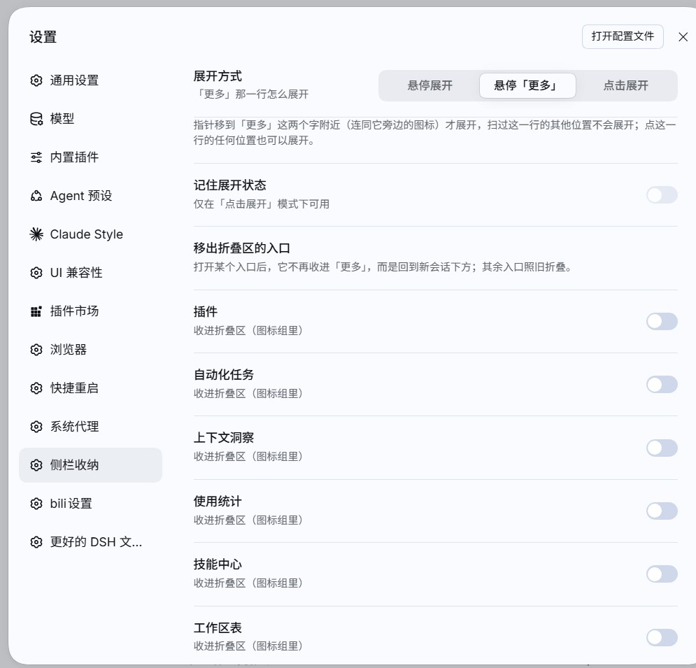
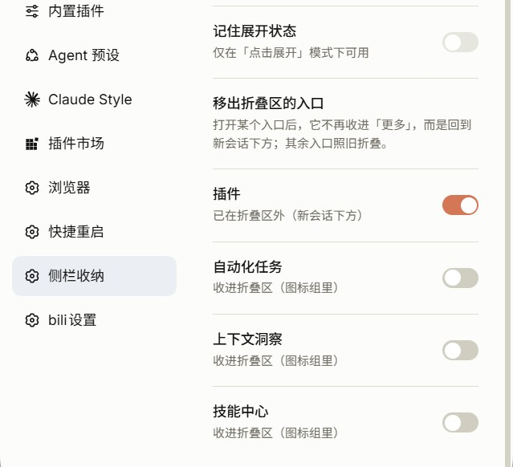

# dsh-sidebar-tidy

> A DSH (DeepSeek Harness) sidebar tidy-up plugin: it tucks the panel icons («Plugins / Schedules / Context Insights / Skills» or their localized names) into a collapsible entry at the bottom of the sidebar, so **New session** stays on top, **Workspaces** takes the middle, and every other entry lives at the bottom — and you can pick individual entries to stay outside the group.

[简体中文](README.md) | **English**

| Before | After (default: collapsed) | After (expanded) |
| :-: | :-: | :-: |
|  |  |  |

*Session list and account row are blurred in the screenshots.*

---

## What it does

| State | Sidebar, top to bottom |
| --- | --- |
| Collapsed (default) | Brand row → New session → **Workspaces (session list, fills the remaining space)** → "⋯ More" → footer user/settings row |
| Expanded (hover mode, default) | Brand row → New session → **Workspaces (session list)** → Plugins / Schedules / Context Insights / Skills + "More" → footer user/settings row |
| Expanded (click mode, optional) | Same as above; the entry row reads "Collapse" while open |
| Entries kept outside (optional) | The entries you tick move back **below New session, above Workspaces**; the rest stay in the "More" group |

- **Moving the pointer onto the "⋯ More" row expands it in place; moving away folds it back** (no popover). The fold is delayed by 220 ms so a grazing pointer does not make it flicker.
- Prefer clicking? **Settings → Sidebar tidy → Expansion mode** switches between the two schemes at any time (see the next section).
- Want an entry to skip the group entirely? **Settings → Sidebar tidy → Entries kept out of the group**, one switch per entry (see the section after that).
- Keyboard users: focusing the entry row (Tab) expands it, losing focus folds it back.
- While collapsed, if a hidden panel is the currently selected one (`aria-current="page"`), a small dot appears on the entry icon.
- Labels follow the DSH locale: "更多" in Chinese, "More" in English; the `title` tooltip says "悬停展开，移开收起" / "Hover to expand · move away to fold".

## Two expansion schemes (Settings → Sidebar tidy)

| Scheme | Interaction | State memory |
| --- | --- | --- |
| **Hover** (default) | Expands as the pointer enters, folds about 0.2 s after it leaves; clicking the row changes nothing | Not remembered — a reload starts collapsed |
| **Click** | Click the "More" row to expand / collapse; its label flips between "More" and "Collapse" | Optional: with "Remember the expansion state" on, the state survives a reload |

- Switching happens inside **Settings → Sidebar tidy** (a segmented control) and takes effect immediately — no restart needed.
- The choice itself lives in `localStorage["dsh-sidebar-tidy:mode"]`; when remembering is on, the open/closed state lives in `dsh-sidebar-tidy:click-open`.
- The page is drawn with DSH's own UI primitives (`SegmentedControl` / `Switch`); if that package cannot be resolved it falls back to self-drawn controls, so the feature still works.
- The default state (no `localStorage` at all) is exactly the 0.1.1 behaviour: hover to expand, nothing remembered.

## Keeping entries out of the group (Settings → Sidebar tidy)

- The lower part of the same page is **"Entries kept out of the group"**: the panel icons that currently exist in the sidebar are listed one by one. Turn a switch on and that row **leaves the group** and returns to its original place — **below New session, above Workspaces**; turn it off and it goes back into "More".
- A kept-out row stays visible in both the collapsed and the expanded state, and it does **not** take part in hover expansion: sweeping the pointer over it never springs the group open (it is no longer part of that group).
- Each row states its current status: "Outside the group (below New session)" or "Folded into the icon group".
- The list follows the sidebar's slot: if you install a plugin that adds a panel icon at runtime, it shows up here too (refreshed when the settings page redraws; no reinstall of this plugin needed).
- The selection lives in `localStorage["dsh-sidebar-tidy:keep"]` as a JSON array of slot entry ids, e.g. `["plugins"]`.

## Install

1. Clone this repository anywhere, e.g. `~/dsh-plugins/dsh-sidebar-tidy`.
2. Link it into your profile's `node_modules`:
   - Windows: `mklink /J "%USERPROFILE%\.dsh\profiles\desktop\node_modules\dsh-sidebar-tidy" "C:\path\to\dsh-sidebar-tidy"`
   - macOS / Linux: `ln -s ~/dsh-plugins/dsh-sidebar-tidy ~/.dsh/profiles/desktop/node_modules/dsh-sidebar-tidy`
3. Register it in `~/.dsh/profiles/<profile>/package.json`:
   - add `"dsh-sidebar-tidy": "link:<path-to-source>"` to `dependencies`
   - add `"dsh-sidebar-tidy"` to `dsh.profile.bundles`
4. Reload the page — that is enough on the desktop profile (no restart needed; if your setup does not pick it up, restart DeepSeek Harness once).

## Uninstall

Remove the line from `dsh.profile.bundles` and restart DeepSeek Harness. On teardown the plugin removes its own stylesheet, sidebar attribute, listeners and settings page; you may clear the `dsh-sidebar-tidy:*` `localStorage` keys, but leaving them behind is harmless.

## How it works (and why it is this small)

The DSH sidebar has no "ordering slot" — sibling order is hard-coded by the shell, and a third-party plugin cannot unregister other plugins' entries. So this plugin never touches the DOM structure; it only uses three tricks:

1. **Reordering with CSS `order`** — the sidebar root is a flex column: `regionArea` (workspaces) gets `order:20`, `panelList` (panel icons) `order:30`, `footArea` (footer) `order:40`, which moves the icon row below the workspaces.
2. **Dissolving the icon group with `display: contents`** — with `nav[class*="_panelList"] { display: contents }` every row inside it becomes a direct flex item of the sidebar column, so each row can carry its **own** `order`: a kept-out row gets `order:15` (back below New session) while the rest of the group stays at `order:30`.
3. **Collapsing with `display:none`** — under `html[data-dsh-sidebar-tidy="folded"]`, every row of the group except the plugin's own entry row and the kept-out rows is hidden.

Which switch maps to which row is the plugin's own problem to solve: sidebar rows carry no id attribute at all, so it reads `ctx.slots.entriesOfSlot('sidebar.panellist')` for `{id, order, label}`, matches rows by their `aria-label` text first and by `order` afterwards, and then writes `data-dsh-tidy-id` / `data-dsh-tidy-keep` onto the rows; after the rows are rebuilt (wide toggle, remount) the next `syncAttr` re-marks them.

The entry button itself is registered through the normal client slot API (`ctx.slots.inject('sidebar.panellist', () => ctx.slots.register({...}))`), so theming, hover and active highlighting all come from the native styles; the entry row also intercepts the sidebar's default `selectPanel(id)` behaviour, because that id has no matching main panel.

The settings page is a second registration into the `settings.section` slot (`id: sidebar-tidy`), so it simply appears next to DSH's own settings pages — no shell changes required.

**Fail-safe by design**: every sidebar CSS selector is prefixed with `html[data-dsh-sidebar-tidy]`, and that attribute is written only after a self-check confirms the real sidebar DOM is present (`nav[class*="_panelList"]`, `div[class*="_regionArea"]`, `div[class*="_footArea"]`). If DSH renames its internal classes, the plugin simply does nothing instead of breaking the UI. Selectors match class *substrings*, so small renames do not matter.

## Files

| File | Purpose |
| --- | --- |
| `lib/index.js` | Host half: empty implementation, only so the profile bundle line can be imported. |
| `lib/client.js` | Browser half: style injection, slot registration (sidebar entry + settings page), state and interaction. |
| `cordis.patch.yml` | Bundle patch layer that inserts `dsh-sidebar-tidy` into the plugin tree. |

## Verified environment

- Verified on a live **DSH 0.2.0-rc.2 (Windows, desktop profile)**: hover-to-expand / move-away-to-fold (including the 220 ms delay), keyboard focus open/close, the collapsed-state dot, localized labels and tooltip, both schemes in the settings page, the "remember" switch surviving a reload, **keeping individual entries out of the group** (the row returns below New session, hover no longer springs the group open, and the choice survives a reload), and a clean rollback after uninstall.
- Coexists with the `dsh-claude-style` skin (it neither touches the sidebar layout classes nor sets `order` on them). Note that the skin collapses `sidebar.footer.action` / the settings row to 0×0, which is why this plugin's entry lives in the last row of `panelList` instead of a footer slot; the settings page still opens normally (the skin merely moves its launcher into its own account popover).
- If another plugin replaces the whole `sidebar` slot (`replaceRisk: shadows-shipped-ui`), the sidebar looks completely different and this plugin silently disables itself via the self-check.

## Compatibility notes

- The `_XXXXXX_*` classes inside the sidebar are DSH internals; if upstream renames the layout classes, update the `SEL_*` constants at the top of `lib/client.js` (one place).
- Keeping entries out relies on `display: contents`: if upstream adds a property that creates a containing block or clips (`transform` / `filter` / `overflow` / `contain`) on the icon group, the per-row reordering may stop working — collapsing still works, the "keep out" part just has no effect.
- Only the panel icons in `sidebar.panellist` are touched; `sidebar.footer.action`, the settings row and other entries stay where they are.
- The settings page occupies a single `settings.section` entry (`id: sidebar-tidy`, `order: 100`); disabling the plugin removes that page and nothing else.

## License

[MIT](LICENSE)