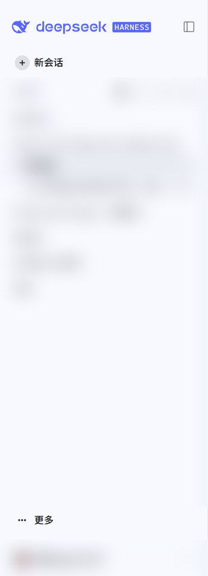
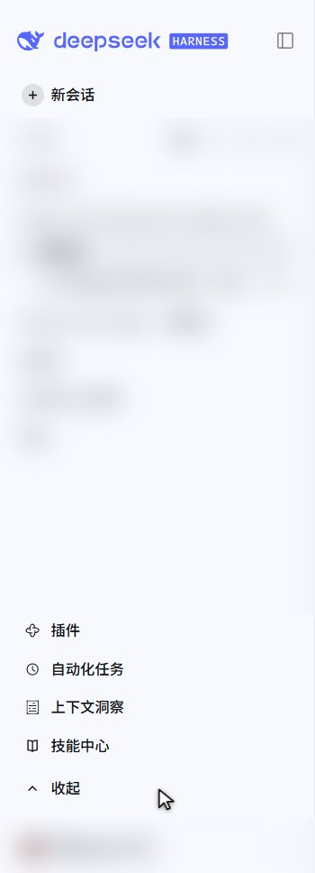

# dsh-sidebar-tidy

> DSH（DeepSeek Harness）侧栏收纳插件：把「插件 / 自动化任务 / 上下文洞察 / 技能中心」这排面板图标收进侧栏底部的可折叠入口，让 **新会话** 在最上、**工作区** 居中、其余入口在最下。

**简体中文** | [English](README.en.md)

| 改造前 | 改造后（默认：折叠） | 改造后（展开） |
| :-: | :-: | :-: |
|  |  |  |

*截图中的会话列表与账号行已打码。*

---

## 效果

| 状态 | 侧栏从上到下 |
| --- | --- |
| 折叠（默认） | 品牌行 → 新会话 → **工作区（会话列表，占满剩余空间）** → 「⋯ 更多」 → 底部用户/设置行 |
| 展开 | 品牌行 → 新会话 → **工作区（会话列表）** → 插件 / 自动化任务 / 上下文洞察 / 技能中心 + 「收起」 → 底部用户/设置行 |

- 点「⋯ 更多」**就地展开**，再点「收起」收起，不弹浮层。
- 状态写在 `localStorage["dsh-sidebar-tidy:folded"]`（`folded` / `expanded`），刷新与下次启动沿用。
- 折叠时若某个被隐藏的面板正处于选中状态（`aria-current="page"`），入口图标右上角会出现一个小圆点提示。
- 文案跟随 DSH 语言：中文「更多 / 收起」，英文 "More / Collapse"。

## 安装

1. 把本仓库放到任意目录，例如 `~/dsh-plugins/dsh-sidebar-tidy`。
2. 链进 profile 的 `node_modules`：
   - Windows：`mklink /J "%USERPROFILE%\.dsh\profiles\desktop\node_modules\dsh-sidebar-tidy" "C:\path\to\dsh-sidebar-tidy"`
   - macOS / Linux：`ln -s ~/dsh-plugins/dsh-sidebar-tidy ~/.dsh/profiles/desktop/node_modules/dsh-sidebar-tidy`
3. 在 `~/.dsh/profiles/<profile>/package.json` 里登记两处：
   - `dependencies` 增加 `"dsh-sidebar-tidy": "link:<源码目录>"`
   - `dsh.profile.bundles` 增加 `"dsh-sidebar-tidy"`
4. 刷新页面即可生效（实测 desktop profile 无需重启；若个别环境未收录，重启一次 DeepSeek Harness）。

## 卸载

从 `dsh.profile.bundles` 移除该行，重启 DeepSeek Harness；顺手可清掉 `localStorage["dsh-sidebar-tidy:folded"]`。

## 实现方式（为什么这么轻）

DSH 侧栏没有「排序槽」——兄弟元素的先后由 shell 写死，第三方也不能注销别人的注册项。所以本插件不改 DOM 结构，只用两件事：

1. **CSS `order` 挪位**：侧栏根节点是 flex column，`regionArea`（工作区）设 `order:20`、`panelList`（面板图标）`order:30`、`footArea`（底部）`order:40`，图标就排到了工作区下方。
2. **`display:none` 折叠**：`html[data-dsh-sidebar-tidy="folded"]` 时，隐藏 `panelList` 内除本插件入口行以外的所有行。

入口按钮本身走客户端槽位 API 正常注册（`ctx.slots.inject('sidebar.panellist', () => ctx.slots.register({...}))`），因此主题、hover、选中高亮全部跟随原生样式；入口行还必须拦掉侧栏默认的 `selectPanel(id)` 行为（该 id 没有对应的 main 面板）。

**失败安全**：所有 CSS 选择器都以 `html[data-dsh-sidebar-tidy]` 打头，而这个属性只有在**自检确认真实侧栏 DOM 就位**（`nav[class*="_panelList"]`、`div[class*="_regionArea"]`、`div[class*="_footArea"]` 同时存在）之后才会写入。DSH 内部类名漂移时，插件只会「不生效」，不会把界面改坏；选择器本身用 `[class*="_panelList"]` 这类子串匹配，抗小版本改名。

## 文件

| 文件 | 作用 |
| --- | --- |
| `lib/index.js` | 宿主半：空实现，只为让 profile 的 bundle 行能被 import。 |
| `lib/client.js` | 浏览器半：样式注入、槽位注册、状态与交互逻辑。 |
| `cordis.patch.yml` | bundle 补丁层，把 `dsh-sidebar-tidy` 插进插件树。 |

## 环境与验证

- 已在 **DSH 0.2.0-rc.2（Windows，desktop profile）** 实机验证：折叠 / 展开、状态记忆与刷新保持、折叠态提示点、中英文文案、卸载后页面完全复原。
- 与 `dsh-claude-style` 皮肤共存正常（该皮肤不触碰侧栏 `_*` 布局类，也不对这些元素设 `order`）。注意它会把 `sidebar.footer.action` / 设置行压成 0×0，所以本插件的入口刻意放在 `panelList` 末行，而不是侧栏底部槽位。
- 若另有插件替换了整个 `sidebar` 槽（`replaceRisk: shadows-shipped-ui`），侧栏结构会完全不同，本插件会因自检不通过而静默不生效。

## 兼容性注意

- 侧栏内部的 `_XXXXXX_*` 类名属于 DSH 内部实现；上游若改布局类名，需要更新 `lib/client.js` 顶部的 `SEL_*` 常量（改一处即可）。
- 只处理 `sidebar.panellist` 里的面板图标；`sidebar.footer.action`、设置行等其它入口保持原位。

## 许可

[MIT](LICENSE)